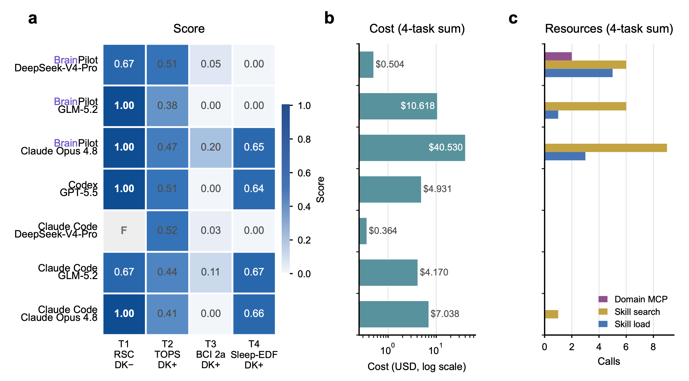

<h1> BrainPilotBench</h1>

<strong>Evaluating AI agents on neuroscience and behavioral research tasks.</strong>

  <strong>v1 task collection</strong> &nbsp;·&nbsp; <strong>118 tasks</strong> &nbsp;·&nbsp; <strong>7 data categories</strong>

  = 22"/>
  
  

  <a href="#project-news">News</a> ·
  <a href="#task-suite">Tasks</a> ·
  <a href="#quick-start">Quick Start</a> ·
  <a href="#evaluate-your-agent">Evaluation</a> ·
  <a href="#brainpilotbench-v0-results">Results</a> ·
  <a href="#citation">Citation</a>

Agents use real datasets to build models and analyses, then submit code, trained models, or other task-defined outputs for evaluation.
Each task provides a research question, data access, an environment, a submission format, and a scoring protocol.

## Project news

- **v1 collection · October–November 2026.** The expansion adds 114 tasks across EEG, psychology, mouse behavior, MRI, connectomics, and invasive recordings. Together with four retained v0 tasks, the collection contains 118 tasks across seven categories. The update includes unified public downloads and separate private evaluation workflows. See the [task suite](#task-suite).
- **July 2026.** BrainPilotBench-v0 became open source with four neuroscience tasks and an agent-independent evaluation framework. Its [reference results](#brainpilotbench-v0-results) remain available.

## Task suite

| Data category | Tasks | Research problems |
|---|---:|---|
| [EEG](tasks/eeg/README.md) | 25 | Motor imagery, evoked responses, sleep staging, and other scalp-EEG classification problems |
| [Psychology](tasks/psychology/README.md) | 76 | Models of participants' choices and responses |
| [Mouse behavior](tasks/animal-behavior/README.md) | 6 | CalMS21 behavior classification and transfer, MABe22 representation evaluation and supervised behavior segmentation, and SAM2Mice identity tracking |
| MRI | 2 | [Structural-MRI age prediction](tasks/mri/brain-age-mri/README.md) and [fMRI tonic-pain prediction](tasks/mri/tops-fmri/README.md) |
| [Connectomics](tasks/connectomics/celegans-structure-function-divergence/README.md) | 1 | Anatomical connectivity and measured signal propagation in C. elegans |
| [Calcium imaging](tasks/calcium-imaging/neuro-rsc-place-cell/README.md) | 1 | Place-cell analysis and decoding from calcium imaging and behavior |
| [Invasive recordings](docs/invasive-task-preparation.md) | 7 | Finger movement, film conditions, motor output, handwriting, and birdsong from ECoG, sEEG, and intracortical recordings |
| **Total** | **118** | **114 additions and four retained v0 tasks** |

### Example tasks

| Research question | Agent output | Evaluation |
|---|---|---|
| [Can trial history predict the next casino choice?](tasks/psychology/psych101-lefebvre2017behavioural-exp1/README.md) | A saved model that predicts response probabilities | Participant-disjoint splits, mean negative log-likelihood per response |
| [Can structural MRI predict age?](tasks/mri/brain-age-mri/README.md) | An inference program that predicts age in years | Held-out participants, mean absolute error in years |
| [Can ECoG predict finger movement?](tasks/ieeg/ieeg-finger-flexion-bciciv4/README.md) | A saved decoder of five finger-flexion trajectories | Guarded chronological split, mean Pearson correlation across three participants and four scored fingers |

### Evaluation status

> [!IMPORTANT]
> **Agent benchmark results for the 114 new v1 tasks are pending.**
> Data checks and fixed-reference runs cover selected workflows. Published Agent results cover the four original v0 tasks.

Individual task READMEs specify the splits, metrics, and validation evidence.
FALCON-derived tasks use BrainPilotBench splits and report adapted-protocol scores.
The [collection guide](docs/shared-task-collection.md) documents reference checks, retained protocols, and candidates excluded from the runnable count.
The [catalog](tasks/catalog.json) lists task IDs and availability.

### v1 data access

Public data cover **117 of 118 tasks**, including all six mouse tasks.
Each hosted task uses `tasks/<category>/<task-id>/public/`, with revisions, sizes, and hashes pinned in its `data.lock`.
H1 requires original-source preparation under its Data Use Agreement. Browse the [public Hugging Face collection](https://huggingface.co/datasets/BrainPilot-Bench/Tasks-Data-Public/tree/main/tasks).

Private evaluator packages cover 35 tasks, with three retained tasks using legacy private routes.
Evaluator-only inputs stay outside Agent workspaces. See the [data preparation guide](docs/data-preparation.md) and [private evaluation guide](docs/private-evaluation.md).

## Quick start

Install Node.js 22 or newer, npm, and Git.
The main branch contains the complete v1 collection described here.

~~~bash
git clone https://github.com/NeuroAIHub/BrainPilotBench.git
cd BrainPilotBench
npm ci
npm run build
npm link
~~~

### Check the installation

Verify and score the supplied example submission, then list the available tasks.
This example checks the submission and scoring commands.

~~~bash
bp-bench submit verify examples/submission
bp-bench score examples/submission
bp-bench leaderboard examples
bp-bench list
~~~

### Prepare a research task

Start with the [fMRI tonic-pain task guide](tasks/mri/tops-fmri/README.md).
Install its task-specific environment, then check requirements and fetch public data.

~~~bash
bp-bench doctor tops-fmri
bp-bench fetch tops-fmri --public
~~~

Each task README specifies its Python, compute, storage, submission, and scoring requirements.

## Evaluate your agent

~~~mermaid
flowchart LR
    A["Task and public data"] --> B["Agent builds a model or analysis"]
    B --> C["Submitted outputs"]
    C --> D["Task-specific evaluation"]
~~~

The `manual` adapter lets an agent work in a prepared workspace.
The `command` adapter runs a local agent command. Use `--adapter brainpilot` for a running BrainPilot deployment.

~~~bash
bp-bench run <task-id> --adapter manual --agent my-agent@1 --fetch \
  --workspace /absolute/outside-git/workspace
~~~

Run your agent in the printed workspace, then execute the printed resume command.
Verify the resulting submission and use the task README's scoring command, including its required isolation and environment options.

~~~bash
bp-bench submit verify "runs/<run-id>"
~~~

Scoring records the task metrics, coverage, and run state. Missing scores and valid zero scores have distinct states.
Maintainers use the private evaluation guide for held-out scoring of frozen submissions.
For the retained fMRI task, gated data access starts with `bp-bench fetch tops-fmri --private`.

## BrainPilotBench-v0 results

The technical report compares seven agent framework and model configurations across the four original tasks.
The figure reports performance, cost, and resource use. See the [v0 technical report](https://arxiv.org/abs/2607.15079).

  

Results are single runs, except for BrainPilot RSC, which uses the higher of two runs as stated in the report.
`F` denotes the absence of a valid primary score. A score of `0.00` is a valid result.
Explore the [v0 leaderboard](https://brainpilot.chat/bench#leaderboard).

## Documentation and contributions

- [Collection guide](docs/shared-task-collection.md) — protocols, validation coverage, and task reuse across independent EEG and psychology research projects.
- [Data preparation](docs/data-preparation.md) and [private evaluation](docs/private-evaluation.md) — downloads, access restrictions, and evaluator setup.
- [Mouse tasks](docs/mouse-task-preparation.md), [SAM2Mice tracking](docs/sam2mice-tracking-preparation.md), and [invasive recordings](docs/invasive-task-preparation.md) — source-specific preparation and scoring.
- [Contributing](CONTRIBUTING.md) — task requirements and framework development. Submit a [task proposal](https://github.com/NeuroAIHub/BrainPilotBench/issues/new?template=task-proposal.yml) for scientific review.
- [Security policy](SECURITY.md) — vulnerability reporting.

## Citation

For BrainPilotBench-v0 or its reference evaluation, cite the technical report.

~~~bibtex
@misc{li2026brainpilotautomatingbraindiscovery,
  title={BrainPilot: Automating Brain Discovery with Agentic Research},
  author={Haoxuan Li and Tianci Gao and Jianhe Li and Yang Fan and Runze Shi
    and Weiran Wang and Tianxiang Zhao and Zezhao Wu and Xiaoyang Jiang
    and Qihui Zhang and Jia Li and Xiao Xiao and Kai Du and Xiaoxuan Jia
    and Chao Xie and Lu Mi},
  year={2026},
  eprint={2607.15079},
  archivePrefix={arXiv},
  primaryClass={cs.AI},
  url={https://arxiv.org/abs/2607.15079}
}
~~~

For v1 tasks, also cite the source datasets listed in each task README.
Report the repository commit, task IDs, scientific protocol versions, and agent framework and model configuration.

## License and contact

Framework code uses the [MIT license](LICENSE). Datasets retain their source-specific terms and citation requirements.
Read each task's data terms before use. BCI IV-4 has no CC or Apache redistribution claim in this repository.

Join the [Slack](https://join.slack.com/t/brainpilot/shared_invite/zt-43pbjtuz5-AiuRez0RIYkzhIsmDQtv8A) or [Feishu](https://applink.feishu.cn/client/chat/chatter/add_by_link?link_token=0far82db-f790-412e-9217-58ae67df4313) community.
For questions, [open an issue](https://github.com/NeuroAIHub/BrainPilotBench/issues/new/choose) or [contact the team](mailto:thu_neuroai@mail.tsinghua.edu.cn).
