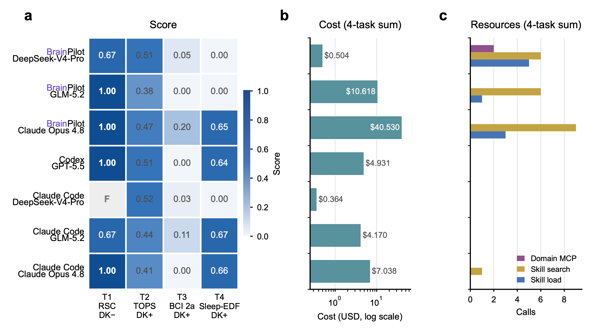

<h1> BrainPilotBench</h1>

<strong>Evaluating AI agents on brain-science and behavioral research tasks.</strong>

From neural recordings to human choices: build models, analyze data, and submit reproducible research artifacts.

  <strong>v1 task collection</strong> &nbsp;·&nbsp; <strong>117 runnable tasks</strong> &nbsp;·&nbsp; <strong>7 data categories</strong>

  
  = 22"/>
  
  

  <a href="#project-news">News</a> ·
  <a href="#task-suite">v1 Tasks</a> ·
  <a href="#v1-data-access">Data</a> ·
  <a href="#quick-start">Quick Start</a> ·
  <a href="#evaluation-status">Evaluation Status</a> ·
  <a href="#brainpilotbench-v0-results">v0 Results</a> ·
  <a href="https://brainpilot.chat/bench#leaderboard">v0 Leaderboard</a> ·
  <a href="#evaluate-your-agent">Evaluate Your Agent</a> ·
  <a href="#citation">Citation</a>

---

## Project news

- **2026-10-27 — Mouse data join the unified HF collection.** Five CalMS21 and MABe22 tasks now have public mirrors and separate private evaluator packages.
  Public coverage reaches 116 of 117 runnable tasks. H1 remains source-only. See the [mouse delivery record](reports/mouse-hf-20261027/publication.json).
- **2026-10-26 — Mouse behavior joins v1.** Five CalMS21 and MABe22 tasks add frame classification, annotation transfer, few-shot behavior recognition and representation evaluation.
  Source preparation, frozen submissions and isolated scoring passed local reference checks. Agent benchmark results remain pending. See the [mouse task guide](docs/mouse-task-preparation.md).
- **2026-10-19 — Private evaluator workflow.** Maintainers can prepare 29 hosted Test packages and score frozen submissions through an explicit private route.
  Test data remain outside Agent workspaces. See the [private evaluation guide](docs/private-evaluation.md) for coverage, source-only exceptions, and representative checks.
- **2026-10-16 — Task guides and public data.** Explore the scientific question, inputs, split, and metric for each task.
  Public data for 111 tasks are available in the [unified Hugging Face collection](https://huggingface.co/datasets/BrainPilot-Bench/Tasks-Data-Public). H1 provides an original-source preparation route.
- **2026-10-15 — BrainPilotBench v1 task collection.** v1 brings **108 new tasks and four retained v0 tasks** into one 112-task collection.
  **Invasive recordings** is a new data category with seven ECoG, sEEG, and intracortical decoding tasks.
  See the [v1 task suite](#task-suite) and [evaluation status](#evaluation-status).
- **2026-07-18** — BrainPilot was showcased at the “Intelligence in the Physical World” Science Forum at WAIC 2026. Follow us for the latest updates.
- **2026-07-17** — BrainPilotBench-v0 was released as open source. It provides four real brain-science tasks for agent-agnostic, artifact-based evaluation of the code, figures, models, and reports produced by scientific agents.

## Overview

BrainPilotBench evaluates AI agents on research problems in brain science and human behavior.
Agents receive task instructions and public data, develop an analysis or model, and submit artifacts for task-specific evaluation.
The tasks include decoding neural activity, predicting human responses, and comparing anatomical connectivity with measured signal propagation.

**BrainPilotBench v1 brings 117 tasks across seven data categories into one shared collection.**
Each task specifies its data, research objective, submission format, and evaluation protocol.
The repository supplies environments and scoring code so that different agents can work on the same problem.

AgentEEGBench and Psych101-Agent-Bench remain independent research projects that can reuse these versioned tasks.
The v1 collection name does not change individual task protocols or transfer results from those projects.

### What a task asks the agent to do

| Research problem | Input and submission | Evaluation |
|---|---|---|
| [Model human casino choices](tasks/psychology/psych101-lefebvre2017behavioural-exp1/README.md) | Use trial history to predict participants' next responses. Submit response probabilities through a saved model. | Participant-disjoint Train/Valid data; mean negative log-likelihood per response. |
| [Predict age from structural MRI](tasks/mri/brain-age-mri/README.md) | Learn from T1-weighted images. Submit an inference program that predicts age in years. | Held-out participants; mean absolute error in years. |
| [Decode finger movement from ECoG](tasks/ieeg/ieeg-finger-flexion-bciciv4/README.md) | Map neural recordings to five finger-flexion trajectories. Submit a saved decoder. | Guarded chronological Train/Valid split; mean Pearson correlation across three participants and four scored fingers. |

## Evaluation status

> [!IMPORTANT]
> **Agent benchmark results for the 113 new v1 tasks are not yet available.**
> Data checks and fixed-reference runs cover selected workflows, not comparative Agent performance across the collection.
> Published v0 results cover only the four original tasks and remain separate below.

The [validation guide](docs/shared-task-collection.md#reference-implementation-checks) distinguishes task preparation, reference checks, and Agent evaluation.

## Task suite

### BrainPilotBench v1 · 117 tasks

Each task defines a research objective, the data available to the agent,
the required outputs, and a task-specific metric.

| Data category | Total tasks | New in v1 | Research tasks |
|---|---:|---:|---|
| [EEG](tasks/eeg/README.md) | 25 | 23 | Motor imagery, evoked responses, sleep staging, and other scalp-EEG classification problems |
| [Psychology](tasks/psychology/README.md) | 76 | 76 | Behavioral models of participants' choices and responses |
| [Mouse behavior](tasks/animal-behavior/README.md) | 5 | 5 | Social behavior classification, annotation transfer, few-shot learning, and fixed-probe representation evaluation |
| MRI | 2 | 1 | [Structural-MRI age prediction](tasks/mri/brain-age-mri/README.md) and [fMRI tonic-pain prediction](tasks/mri/tops-fmri/README.md) |
| [Connectomics](tasks/connectomics/celegans-structure-function-divergence/README.md) | 1 | 1 | Comparison of anatomical connectivity and measured signal propagation in C. elegans |
| [Calcium imaging](tasks/calcium-imaging/neuro-rsc-place-cell/README.md) | 1 | 0 | Place-cell analysis and decoding from calcium imaging and behavior |
| [Invasive recordings](#invasive-recordings) | 7 | 7 | Finger flexion, film conditions, motor output, handwriting, and birdsong from invasive neural recordings |
| **Total** | **117** | **113** | **Four v0 tasks are retained within the total.** |

**Explore a task:** [AlexMI motor imagery](tasks/eeg/eeg-mi-barachant2012/README.md)
· [Casino choice](tasks/psychology/psych101-lefebvre2017behavioural-exp1/README.md)
· [Category learning](tasks/psychology/psych101-badham2017deficits-exp1/README.md)
· [MRI age prediction](tasks/mri/brain-age-mri/README.md)
· [C. elegans network comparison](tasks/connectomics/celegans-structure-function-divergence/README.md)
· [Handwriting from neural activity](tasks/intracortical/falcon-h2-handwriting/README.md)

### Invasive recordings

This v1 data category contains seven tasks from real invasive recordings.
It combines [clinical ECoG and sEEG](tasks/ieeg/README.md) with [intracortical recordings](tasks/intracortical/README.md) in humans, macaques, and songbirds.
These recording types share one category while retaining their distinct input formats and scientific protocols.

| Task | Prediction target | Primary metric |
|---|---|---|
| [BCI IV-4](tasks/ieeg/ieeg-finger-flexion-bciciv4/README.md) | Five finger-flexion trajectories from human ECoG | Mean Pearson r across three participants and four scored fingers |
| [Film conditions](tasks/ieeg/ieeg-film-speech-music/README.md) | Speech or music in unseen film blocks from clinical ECoG/sEEG | Participant-macro, block-first balanced accuracy |
| [FALCON H1](tasks/intracortical/falcon-h1-reach-grasp/README.md) | Seven attempted arm/grasp velocity components | Date-mean variance-weighted R² |
| [FALCON H2](tasks/intracortical/falcon-h2-handwriting/README.md) | Attempted handwriting sentences | Date-mean word error rate |
| [FALCON M1-A](tasks/intracortical/falcon-m1-emg/README.md) | Sixteen upper-limb muscle activity channels | Date-mean variance-weighted R² |
| [FALCON M2](tasks/intracortical/falcon-m2-finger-velocity/README.md) | Two finger-group velocities | Date-mean variance-weighted R² |
| [FALCON B1](tasks/intracortical/falcon-b1-birdsong/README.md) | Zebra finch vocalization spectrograms | Normalized spectrogram MSE |

The FALCON-derived tasks use BrainPilotBench splits. Their scores are not official FALCON leaderboard results.
The [invasive-recording guide](docs/invasive-task-preparation.md) describes public data access, model interfaces, and the separate reference checks.

### Retained v0 protocols · 4 tasks

These four tasks are included in v1's 117-task total, not added on top of it.
They retain their IDs, scientific protocol versions, and historical v0 results.

View the four retained task protocols

| Task | Capability | Compute | Primary scoring |
|---|---|---|---|
| [<code>neuro-rsc-place-cell</code>](tasks/calcium-imaging/neuro-rsc-place-cell/README.md) | RSC calcium imaging, virtual-reality behavior, place-cell analysis, and decoding | CPU | Deterministic checks + human rubric |
| [<code>tops-fmri</code>](tasks/mri/tops-fmri/README.md) | Functional-connectivity modeling and held-out tonic-pain prediction | CPU | Study4 Pearson r + Study5 AUC |
| [<code>bciciv-2a</code>](tasks/eeg/bciciv-2a/README.md) | Four-class motor-imagery EEG decoding | GPU | Held-out accuracy + Cohen's kappa |
| [<code>sleep-edf</code>](tasks/eeg/sleep-edf/README.md) | Five-class sleep staging | GPU | Held-out Cohen's kappa + per-class recall |

The [machine-readable catalog](tasks/catalog.json) lists task IDs and availability.
`bp-bench list` shows runnable packages only.
See the [collection guide](docs/shared-task-collection.md) for protocol differences,
data roles, and reuse across independent research projects.

### v1 data access

Browse the [Hugging Face task directory](https://huggingface.co/datasets/BrainPilot-Bench/Tasks-Data-Public/tree/main/tasks) for public data from 116 tasks, including BCI IV-4 and the five mouse tasks.
Each task has one directory: `tasks/<category>/<task-id>/public/`.
Its `data.lock` pins the download revision, file sizes, and hashes. Mirroring preserves each prepared file's format and bytes.

H1 uses original-source download and local preparation because its Data Use Agreement prohibits redistribution.
The five mouse tasks use the same directory layout and pinned downloads. Original-source preparation remains available for regeneration.
The [mouse task guide](docs/mouse-task-preparation.md) describes public preparation, private evaluation, and source-specific license notices.
The film task's public package supports Agent preparation, but block-first scoring still requires a trusted evaluator mapping.
Source terms and citation instructions remain task-specific. Evaluator-only inputs are separate from public data.

Install the environment in the task README, then prepare one hosted task:

~~~sh
node dist/cli.js prepare <task-id> --fetch --workspace /absolute/outside-git/workspace
~~~

See the [data guide](docs/data-preparation.md) for delivery checks, fixed snapshots, and preparation details.

### Private evaluation for maintainers

The [private collection](https://huggingface.co/datasets/BrainPilot-Bench/Tasks-Data-Private/tree/main/tasks) provides canonical evaluator packages for 34 tasks: the earlier 29 plus five mouse tasks.
Three retained legacy tasks keep their existing private routes. Each task's locks select its fixed data revision.
Use `prepare-evaluator` to create an owner-only data directory, then `score --private` to evaluate a frozen submission.
Private results go to `scores.private.json`; public validation and its results stay separate.
The [maintainer guide](docs/private-evaluation.md) lists the commands, environments, source restrictions, and validation limits.
This data and interface update does not add Agent benchmark results.

Candidates outside the 117 runnable tasks

Four EEG entries remain preparation-only: HMC sleep stage, HMC sleep onset, Sleep-EDF onset, and CHB-MIT seizure detection.
Thielen2021 remains withheld. These five EEG candidates are outside the runnable task count.
Three [Airscope candidates](tasks/calcium-imaging/README.md) remain pending experimental data or protocol definitions.
The social-competition source has a 17-sample validation cache with PCA fitted to whole recordings before trial extraction.
Complete signals and trial identities remain missing. They are needed for a separate BrainPilotBench split with training-only preprocessing.
Candidate packages and evaluator-only inputs are not included in the unified public layout.

## BrainPilotBench-v0 results

The [BrainPilot technical report](https://arxiv.org/abs/2607.15079) evaluates seven
harness–backbone configurations across all four BrainPilotBench-v0 tasks. BrainPilot
matched or approached the strongest evaluated configurations on multiple tasks, with
a performance–cost trade-off across backbones.

  

Except for the BrainPilot RSC result, which follows the report's stated selection of the
higher of two runs, all results are single runs. <code>F</code> denotes the absence of a
valid primary score and is distinct from <code>0.00</code>. These are reference runs from
the technical report.

  <a href="https://brainpilot.chat/bench#leaderboard"><strong>Explore the BrainPilotBench-v0 evaluation →</strong></a>

## Quick start

### Requirements

- [Node.js](https://nodejs.org/) 22 or newer
- npm
- Git
- Any task-specific Python, CPU, GPU, or storage requirements listed in its task README

The unified download and private evaluation workflow entered main through [PR #77](https://github.com/NeuroAIHub/BrainPilotBench/pull/77).
The mouse-task increment is under review in [PR #80](https://github.com/NeuroAIHub/BrainPilotBench/pull/80).
Use its source branch for the complete workflow below. This update is not an npm release.

~~~bash
git clone --branch feat/mouse-behavior-task-expansion https://github.com/NeuroAIHub/BrainPilotBench.git
cd BrainPilotBench
npm ci
npm run build
npm link
~~~

Run the zero-key example:

~~~bash
bp-bench submit verify examples/submission
bp-bench score examples/submission
bp-bench leaderboard examples
~~~

List the current tasks:

~~~bash
bp-bench list
~~~

Before starting a full task, read its linked README and run:

~~~bash
bp-bench doctor tops-fmri
bp-bench fetch tops-fmri --public
~~~

## How it works

~~~mermaid
flowchart LR
    A["Task specification"] --> B["Agent or harness"]
    B --> C["Submission bundle"]
    C --> D["Contract verification"]
    D --> E["Task-declared scorer"]
    E --> F["Scores and coverage"]
~~~

1. A task defines the research goal, inputs, prompts, and required artifacts.
2. An agent works in its native environment and produces a submission bundle.
3. BrainPilotBench verifies that the bundle satisfies the task contract.
4. The task-declared grader evaluates the submitted artifacts.
5. Scores retain coverage and run-state information so missing measurements are not
   silently converted to zero.

## Evaluate your agent

BrainPilotBench provides three adapters:

| Adapter | Use case |
|---|---|
| <code>brainpilot</code> | A running BrainPilot deployment |
| <code>command</code> | A local agent command |
| <code>manual</code> | Any other harness using a prepared workspace and resume step |

For an agent-independent manual handoff:

~~~bash
bp-bench run <task-id> --adapter manual --agent my-agent@1 --fetch \
  --workspace /absolute/outside-git/workspace
~~~

Run your agent in the printed workspace, then execute the printed resume command. Verify
and score the resulting bundle:

~~~bash
bp-bench submit verify "runs/<run-id>"
bp-bench score "runs/<run-id>"
~~~

To run against BrainPilot:

~~~bash
bp-bench run <task-id> \
  --adapter brainpilot \
  --base-url http://127.0.0.1:9001 \
  --workspace-root /absolute/path/to/workspaces \
  --agent brainpilot@<commit>
~~~

The built-in adapters all produce the same submission-bundle contract. This keeps task
scoring independent of the agent language, model provider, and orchestration framework.

## Scoring and integrity

- Each task declares its required artifacts and grader.
- Deterministic metrics, held-out evaluation, and expert rubrics are used where appropriate.
- A valid score of <code>0.00</code>, an unscored run, and a metric that does not apply are
  represented as different states.
- Public inputs are pinned by content hash; evaluator-only inputs remain outside the agent
  workspace.
- Official results are produced from preserved artifacts and run metadata rather than
  accepted as self-reported numbers.

Maintainers with gated evaluator access follow the task-specific instructions; for example,
<code>bp-bench fetch tops-fmri --private</code>. Private inputs are never staged in the agent
workspace.

## Documentation and contributing

- Start with the [task-specific READMEs](#task-suite) for setup and evaluation instructions.
- See [CONTRIBUTING.md](CONTRIBUTING.md) to propose tasks or contribute framework changes.
- See [SECURITY.md](SECURITY.md) to report a vulnerability.
- Open a [Task Proposal](https://github.com/NeuroAIHub/BrainPilotBench/issues/new?template=task-proposal.yml)
  for a new brain science workflow.

BrainPilotBench is a curated benchmark. Maintainers review scientific construct validity,
data provenance, scoring design, and contamination risk before adding a task.

## Citation

If BrainPilotBench has helped your work, we welcome you to cite our work!

If you use BrainPilotBench-v0 or its reference evaluation, cite the technical report:

~~~bibtex
@misc{li2026brainpilotautomatingbraindiscovery,
  title={BrainPilot: Automating Brain Discovery with Agentic Research},
  author={Haoxuan Li and Tianci Gao and Jianhe Li and Yang Fan and Runze Shi
    and Weiran Wang and Tianxiang Zhao and Zezhao Wu and Xiaoyang Jiang
    and Qihui Zhang and Jia Li and Xiao Xiao and Kai Du and Xiaoxuan Jia
    and Chao Xie and Lu Mi},
  year={2026},
  eprint={2607.15079},
  archivePrefix={arXiv},
  primaryClass={cs.AI},
  url={https://arxiv.org/abs/2607.15079}
}
~~~

For v1 tasks, also cite the source datasets listed in each task README.
For reproducibility, report the repository commit, task IDs and scientific protocol versions, and the
evaluated harness–model configuration.

## Community

Questions, ideas, or just want to say hi? Join the BrainPilot community:

- 💬 **[Join the BrainPilot Slack →](https://join.slack.com/t/brainpilot/shared_invite/zt-43pbjtuz5-AiuRez0RIYkzhIsmDQtv8A)**
- 🪶 **[Join the BrainPilot Feishu group →](https://applink.feishu.cn/client/chat/chatter/add_by_link?link_token=0far82db-f790-412e-9217-58ae67df4313)**
- 📧 **Contact:** [thu_neuroai@mail.tsinghua.edu.cn](mailto:thu_neuroai@mail.tsinghua.edu.cn)

You can also [open an issue](https://github.com/NeuroAIHub/BrainPilot/issues/new/choose)
or start a discussion.

## License

The framework package is licensed under MIT.
The hosted datasets retain their original source terms. The MIT license does not grant rights to those data.
Read each task's source and citation instructions before use. In particular, this repository makes no CC or Apache redistribution claim for BCI IV-4.

---

**Build, evaluate, and share agents for brain and behavioral research.**

