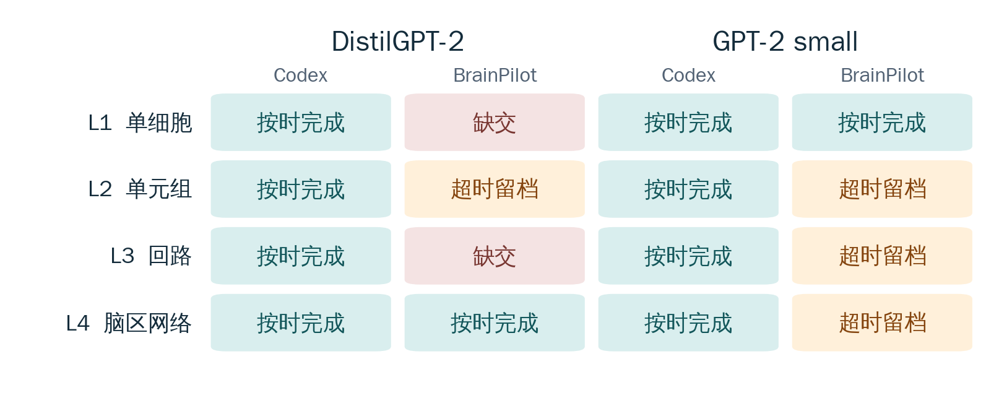
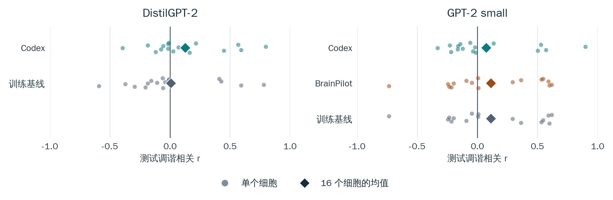
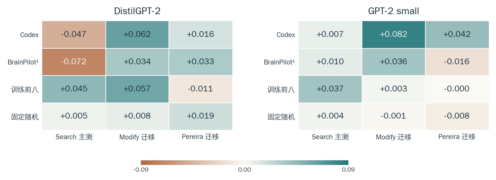
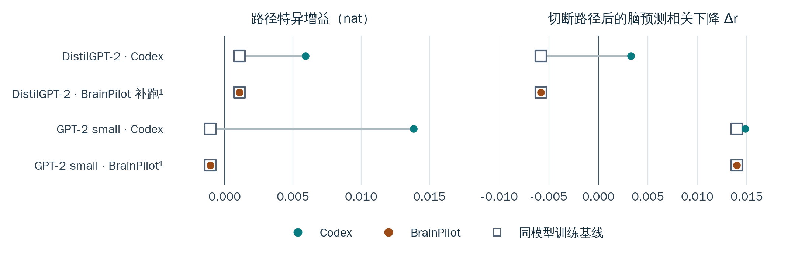
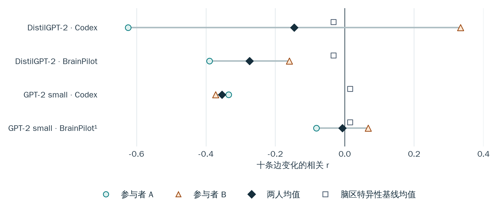

# 语言模型与人脑怎样对齐？四个开放探索任务与两套 Agent 的实测

**BrainPilotBench 中文入门报告 · 实验记录截至 2026 年 11 月 25 日 · 协议版本 v1**

假设给两位研究者同一批脑记录、同一个语言模型和半小时。你可以直接告诉他们看哪个模型单元，也可以只告诉他们怎样算分，让他们自己选单元、写程序、检验自己的选择。本报告记录第二种实验。两位“研究者”分别由 Codex 和 BrainPilot 组织，底层研究模型都用 GPT‑6.1 Sol。BrainPilotBench 是存放任务、隔离研究工作区、回收提交并计算分数的基准项目。它把“这一项研究能否做成”具体化为一次可以复核的运行。真正被打开、读取内部活动并与人脑比较的模型是 DistilGPT‑2 和 GPT‑2 small。

四个层级各问一个可以实测的问题。L1 看单个细胞和模型单元是否偏好相似的词。L2 看一小组单元能否预测新句子引起的脑响应。L3 在模型中改变一条路径，再测续词和脑预测分别变了多少。L4 检查五个区域之间的关系能否被模型重现。每个任务都有一个预先写好的简单选择算法作为基线，用来判断自主探索带来了多少额外收益。

在 GPT‑2 small 中，Codex 找到一条路径，使目标词的对数概率比替换其他头多恢复 **0.01383 nat**，固定训练基线为 **−0.00105 nat**。还是这个模型，若改问“五个脑区之间的关系能否重现”，Codex 的盲测相关却为 **−0.35371**。同一模型可以在一个明确的局部问题上提供证据，在另一个尺度上失去预测力。下文给出每个分数的观测单位、对照和适用范围。

**阅读路线**　第一次接触脑数据，可从[谁在实验、怎么读分](#primer)和[数据与模型](#materials)开始。关心算法可直接看 [L1 单细胞](#task-l1)、[L2 单元组](#task-l2)、[L3 路径](#task-l3)、[L4 网络](#task-l4)。比较两套系统请结合[主结果](#overview)、[运行与资源](#harness)和[复核入口](#reproduce)。[指标的文献来历](#sources)给出原始论文和作者数据。

## 一、主比较的 16 个位置

四个问题 × 两个评测模型 × 两种研究者运行时，得到 16 个主比较位置。每个位置取指定批次的一次运行。L2 的 BrainPilot 使用解除 API 总额度后从头运行的批次，早期预算试验在文末单列。下表均为隐藏测试材料上的测量，保留五位小数。每行只在同一任务、同一模型和同一划分内比较。固定训练基线的算法随任务而变，随机基线见各章。

| 任务与主指标 | 评测模型 | 固定训练基线 | Codex | BrainPilot |
|---|---|---:|---:|---:|
| L1 单细胞语义调谐 `r` | DistilGPT‑2 | +0.00783 | **+0.12607** | 缺交 |
| L1 单细胞语义调谐 `r` | GPT‑2 small | **+0.11243** | +0.07150 | **+0.11243** |
| L2 八单元预测增量 `Δr` | DistilGPT‑2 | **+0.04488** | −0.04655 | −0.07219¹ |
| L2 八单元预测增量 `Δr` | GPT‑2 small | **+0.03707** | +0.00727 | +0.00957¹ |
| L3 路径特异增益，nat | DistilGPT‑2 | +0.00109 | **+0.00592** | 缺交 |
| L3 路径特异增益，nat | GPT‑2 small | −0.00105 | **+0.01383** | −0.00105¹ |
| L4 脑区共变边变化 `r` | DistilGPT‑2 | **−0.03240** | −0.14568 | −0.27491 |
| L4 脑区共变边变化 `r` | GPT‑2 small | **+0.01528** | −0.35371 | −0.00721¹ |

¹ **超时留档**表示原生会话在 30 分钟时仍未结束，截止时已有两份交付物，维护者随后在断网环境复跑并测得表中数值。**缺交**表示截止前或会话结束时缺少合格的完整提交，科学分数留空。粗体为该行最高值。

**图 1　交付状态和科学分数要分开读。** Codex 正常完成 8/8。BrainPilot 正常完成 2/8，另外 4/8 超时留档，2/8 缺交。合计 10 次正常完成、4 次超时留档，14 份主比较产物通过离线复跑。两个缺交格各有一次独立补跑，原记录保留，结果见 L1 和 L3 章节。

## 二、谁在实验，怎么读分

**研究者、试验对象、裁判各有职责。** Agent 是会规划、调用工具、读回执、提交程序的研究者。harness 是组织这项工作的运行时。Codex CLI 在隔离工作目录内运行命令和编写代码。BrainPilot 原生运行时由协调者分派职责，可以创建工程、分析、审计等角色并调用工具。双方都能自由决定寻找哪些候选、做何种训练验证、是否查询开发集。评测模型提供内部数值，权重在实验中冻结。独立评分程序持有隐藏脑数据，按相同规则测量两套方案。[任务入口](../../tasks/alignment/README.md) · [工作区与提交包实现](../../src/workflow.ts)

**先分清测量单位。** token 是分词器实际处理的文本片段，一个词可能跨多个 token。注意力头能根据当前位置和前文计算加权信息，前馈网络 MLP 的中间通道会随输入产生不同的数值。本文把这样一个通道称为“模型单元”。单细胞电记录测一个神经元的放电，fMRI 测与血氧变化相关的信号。体素是扫描图像中的一个三维测量单元，ROI 是感兴趣脑区，可以汇总区内许多体素。共同刺激和共同测量噪声都可能使多处信号一起变化。[模型特征提取](../../tasks/alignment/_shared/unit_transfer/features.py) · [Jamali 单细胞研究](https://www.nature.com/articles/s41586-024-07643-2) · [Tuckute 语言网络研究](https://doi.org/10.1038/s41562-023-01783-7)

| 读数 | 怎样算 | 怎样理解 |
|---|---|---|
| Pearson 相关 `r` | 两列数分别减去各自的均值，比较成对变化方向，范围从 −1 到 +1 | 一列变大时另一列也倾向变大，`r` 为正。`r = 0.10` 描述线性关联强弱，不能读成“10% 的脑活动” |
| 相关增量 `Δr` | 同一批真实观测分别与两组预测求相关，再将两次相关相减 | 假设仅用控制变量时 `r = 0.20`，加入八个模型单元后 `r = 0.24`，增量就是 `+0.04`。L3 辅助指标比较完整模型和切断路径的模型 |
| 对数概率增益，nat | 用自然对数比较模型给同一目标 token 的概率，按预设干预和对照取差 | `ln(0.22) − ln(0.20) ≈ 0.0953 nat` 是一次示意干预的恢复量。L3 还要减掉其他头的平均恢复量，再跨句取均值 |
| 岭回归读出 | 在训练样本上拟合“模型特征 → 脑响应”的线性关系，用惩罚项约束过大的系数 | 新句子的特征进入已经学好的读出，得到脑响应预测。这里固定惩罚强度 `α = 100`，特征标准化只从拟合数据估计，截距不受惩罚 |

表中小数算例为教学示意。后文所有实测和基线均来自真实运行记录。L1 的相关沿**九个语义域**计算，L4 沿**十条脑区对**计算，L2 的相关沿句子计算。L3 主指标直接读模型的对数概率。把四种数值放在同一排行榜上取平均，会丢掉各自的科学含义。[读出与相关实现](../../tasks/alignment/_shared/multiscale/analysis.py)

### 从公开训练到盲测

1. **开题。** 维护者为每个评测模型准备只读训练包，给每次运行独立身份和工作区。Agent 能看到任务合同、训练数据、合法提交格式和公开包指纹。原始源文件、隐藏分区、评分程序和其他会话留在维护者侧。
2. **探索。** Agent 用本机程序比较候选。开发服务对每个身份最多回答两份不同选择，每次只给主分。重复查询同一选择会得到原回执。L3 还可反复在公开训练句上测量真实干预效果，训练次数与开发额度分开。
3. **提交。** `choice.json` 写最终选择，`strategy.py` 给出重建该选择的程序。L1、L3、L4 还要求在揭晓前预测最终主分，L3 另写什么观察能推翻自己的路径解释。L2 的合同只要求单元选择。研究窗口均为每组 30 分钟。
4. **冻结和复跑。** 维护者固定代码指纹、选择、公开包身份及真实回执，在无网络 Docker 中给程序提供公开包、冻结反馈和临时输出。复跑限制为 120 秒、2 核、2 GiB。程序须重现规范化后的选择及合同要求的预测等字段。然后由维护者用隐藏数据评分。
5. **揭晓。** 科学分数衡量候选的留出效果，复跑检验程序和提交的一致性，运行日志记录是否交付及耗用的资源。固定训练基线同样可以完美复跑，因此还要检验自主搜索是否胜过简单策略。[查询与冻结](../../tasks/alignment/_shared/unit_transfer/session.py) · [离线复跑](../../tasks/alignment/_shared/unit_transfer/replay.py) · [研究工作区与盲评指南](../../tasks/alignment/_multiscale/DISCOVERY.zh-CN.md)

## 三、原始研究、数据与模型

项目设计稿把比较尺度追溯到 Xu 等的综述稿 *Beyond Representational Alignment: Comparing Functional Organization in the Brain and Artificial Networks with a Multiscale Framework*。设计稿引用其表 1 区分单元、群体表征、回路、网络、全系统五种观察尺度，引用其表 2 区分识别、验证、因果检验与泛化四种证据。这里沿用项目设计稿的归属，公开出版信息尚待核实。一个例子是，先找到一组对同类词敏感的单元，就得到候选。换一批词还能预测，才有泛化证据。在模型里切掉一条连接并观察到输出改变，则是在这个模型内做了因果检验。下文四个分数是 BrainPilotBench 为四种具体实验定义的操作指标。[项目设计稿及层级表](../alignment-multiscale-agent-demo-plan.zh-CN.md)

### 三套人脑数据各测了什么

**Jamali 等，单个神经元在听句时如何响应。** 2024 年的 *Nature* 研究在参与者聆听英语时，从语言优势侧的左前额叶记录单神经元放电。13 位参与者合计贡献 287 个记录单元。作者依据词向量聚类得到九个语义域，包括动作、状态、物体、食物、动物、自然、人物与家庭、人名、时空关系。研究者把放电对齐到每个词的起点，用双侧秩和检验比较某一域和其余域，对九次比较校正假发现率，并用选择性指数描述偏好集中程度。按论文标准，有 48 个记录单元显示语义选择性。[Jamali 等原论文与方法](https://pmc.ncbi.nlm.nih.gov/articles/PMC11254762/)

L1 读取作者 Figshare v1 的两份预处理表。`neuronal_activity_sentence.pickle` 给出听句时与词对应的放电率、试次及类别，`spherecluster_w2v_embeddings.pickle` 给出词及其 Word2Vec 聚类归属。模型侧在统一载句中读探测词，以语义域为共同刻度。项目用训练试次分半后的可重复性重新筛选细胞，本轮得到 16 个。论文的 48 和本轮的 16 来自两种不同的筛选标准。听者经历了自然语句及其上下文，模型收到固定书面载句，因此最终相关描述跨这两种输入条件保留下来的域偏好。[作者数据 v1，CC BY 4.0](https://doi.org/10.6084/m9.figshare.26046127.v1) · [L1 数据处理与评分](../../tasks/alignment/_shared/discovery/cells.py)

**Tuckute 等，哪些句子能调高或调低语言网络的响应。** 作者在 *Nature Human Behaviour* 的研究先测量 5 位参与者阅读 1,000 个基线句时的 fMRI 响应，用 GPT‑2 XL 的句末表示拟合编码模型。随后在约 180 万个句子中搜索，挑出模型预测反应高的 250 句和低的 250 句，让另外 3 人阅读，这组材料叫 **search**。补充实验的 **modify** 从种子句出发，替换部分词以推高或压低预测值，另得 250 + 250 句，由另外 2 人阅读。D（drive）和 S（suppress）标识原实验的刺激选择条件。每个句子、每位参与者的真实测量值仍然会波动。[Tuckute 等原论文](https://doi.org/10.1038/s41562-023-01783-7) · [论文摘要与出版信息](https://pubmed.ncbi.nlm.nih.gov/38172630/) · [作者补充材料 SI 16](https://static1.squarespace.com/static/64c800a2f333f04f50bf2020/t/66f46fe940097d1e780f8ed4/1727295476740/Tuckute_et_al_2024_NatHumBeh_SI.pdf)

本项目使用作者通过 OSF 发布的事件相关主表 `brain-lang-data_participant_20230728.csv`。它保存按句、参与者和感兴趣脑区（ROI）估计的响应。五个左半球语言区位于额下回眶部、额下回、额中回、前颞及后颞，另有语言网络均值。BOLD fMRI 依赖血氧变化，逐句响应是从扫描信号估计的数值，空间和时间尺度都与 Jamali 的单细胞放电不同。按五位训练参与者的响应是否齐全过滤后，1,000 个基线句中有 988 句进入本项目训练池。L2 从这张表取语言网络均值，L3 从中选原句并另造配对，L4 保留五区分别的响应。三者共享数据来源，提供的证据也因此有关联。D/S 刺激原先依据 GPT‑2 XL 的预测挑选，两款评测模型又与它同属 GPT‑2 家族。这是刺激如何被选入实验的限制，即使正确隔离测试集，仍会影响结论能否推广到任意自然句。[作者代码与数据字典入口](https://github.com/gretatuckute/drive_suppress_brains/tree/7175a12dc25f8765e2fb2196d71c2ea98e97604b) · [OSF 数据项目](https://osf.io/ru38b/) · [本项目训练池筛选](../../tasks/alignment/_shared/expansion/selection.py) · [BOLD 信号与神经活动的实测关系](https://pubmed.ncbi.nlm.nih.gov/11449264/)

**Pereira 等，读连续短文时脑活动包含哪些语义信息。** 2018 年 *Nature Communications* 论文在一项实验中用脑活动学习预测词义向量，随后测试能否从阅读新句子时的脑活动解出句义。这里的 **Pereira384** 指论文实验 2 的材料，共 24 个主题、96 篇短文、每篇 4 句。人按段落顺序阅读，扫描可给出逐句脑响应。原论文图 4 和方法部分的该实验解码分析列 8 位参与者。后续语言预测基准的 384 句版本列 9 位，当前 L2 固定使用这一发布包中的 9 位。区分这两个口径有助于对照原文和运行结果。[Pereira 等原论文，方法与图 4](https://web.mit.edu/bcs/nklab/media/pdfs/Pereira2018.pdf) · [作者数据与刺激说明](https://web.mit.edu/evlab/sites/default/files/documents/index2.html) · [后续基准对九人分区的说明](https://pmc.ncbi.nlm.nih.gov/articles/PMC11025646/)

L2 读取 Brain-Score 发布的 `Pereira2018.language` 测量矩阵。它把每句单独送入语言模型，保留先在 Tuckute 上选定的单元，再用 Pereira 的训练材料为每位参与者重新拟合模型激活到脑响应的映射。测试留出完整段落及其所属主题。所以这里的“跨数据集迁移”检验的是同一组单元能否用来预测另一项实验，读出权重允许适应新被试和新数据。[Brain-Score 数据登记](https://github.com/brain-score/language/tree/main/brainscore_language/data/pereira2018) · [本项目 Pereira384 准备与主题划分](../../tasks/alignment/_shared/unit_transfer/data.py) · [L2 协议](../../tasks/alignment/_multiscale/UNIT_TRANSFER.zh-CN.md)

### 从原有研究方法到四个评分指标

| 本项目主指标 | 原有研究怎样取得证据 | 本项目把什么变成可评分的预测 |
|---|---|---|
| L1 单细胞调谐 `unit_tuning_r` | Jamali 等检验单个细胞是否选择性响应某个语义域。 | Agent 为每个固定细胞挑一个模型 MLP 单元。人和模型各自求出九个域的平均响应，在新试次和新探测词上比较两条九点曲线的有符号相关，再对细胞等权平均。[Jamali 等](https://pmc.ncbi.nlm.nih.gov/articles/PMC11254762/) · [评分实现](../../tasks/alignment/_shared/discovery/cells.py) |
| L2 增量编码 `search_delta_r` | Schrimpf 等（2021）用模型特征拟合人脑测量，在留出材料上检验预测，并按测量的可靠性上限归一化。这里直接报告两个原始预测相关的差。AlKhamissi 等（2025）用功能定位找语言选择性单元并做消融和脑对齐比较。Lepori 等 2026 年的预印本在稀疏特征编码中显式建模词的惊讶度。 | 固定 8 个原生单元，在同一批留出句上比较两套线性读出。一套仅有 token 数和平均惊讶度，一套再加 8 个单元。两个相关的差衡量新增单元带来的预测变化。项目同时保留两项迁移分。[Schrimpf 等原论文全文](https://pmc.ncbi.nlm.nih.gov/articles/PMC8694052/) · [功能定位与消融](https://aclanthology.org/2025.naacl-long.544/) · [控制惊讶度的稀疏编码研究](https://arxiv.org/abs/2606.06857) · [L2 评分协议](../../tasks/alignment/_multiscale/UNIT_TRANSFER.zh-CN.md) |
| L3 路径特异增益 `path_specific_gain` | Wang 等（2022 年预印本）在 GPT‑2 small 的间接宾语识别任务中定位电路。Goldowsky-Dill 等（2023）将路径替换系统化，用对内部路径的干预检验模型行为依赖哪条信息通路。 | 取同一句的正常和扰乱前缀，只把选中头的特定贡献送回指定的 8 个接收单元。相比同层其他头，选中路径额外恢复多少目标 token 的对数概率，就是主分。对人脑的预测有独立辅助分 `brain_delta_r`，对应人类看到的原句。[GPT‑2 电路实验](https://arxiv.org/abs/2211.00593) · [路径替换方法](https://arxiv.org/abs/2304.05969) · [实际干预实现](../../tasks/alignment/_shared/discovery/path_model.py) |
| L4 区域共变 `network_edge_r` | Rissman、Gazzaley 和 D’Esposito（2004）在事件相关 fMRI 中为各个试次、任务阶段估计独立的响应系数（β），把同阶段的系数排成序列，考察不同脑区在试次间的波动是否相关。 | 对模型的 5 个单元组和人脑的 5 个区域各算 10 条无向边。每条边先算 D 条件相关减 S 条件相关，再比较模型和人脑的两组十维变化，逐人求相关、跨人平均。共同刺激也能引起两个区域一起波动，因而该分数支持对条件相关共变结构的判断。推断有向生理连接需要额外证据。[Rissman 等的方法](https://pubmed.ncbi.nlm.nih.gov/15488425/) · [本项目的去均值、边相关和置换](../../tasks/alignment/_shared/network_edges/scoring.py) |

### 两款被研究的模型

GPT‑2 是根据已有文本前缀预测下一个 token 的 Transformer。一个 token 是分词器的基本单位，一个英文词可以由多个 token 构成。一个 Transformer 块包含在前文位置间传递信息的注意力头，以及对当前位置做非线性变换的前馈网络（MLP）。项目把 GPT‑2 每层 MLP 内部、非线性激活之后、输出投影之前的一列数值称为一个“原生单元”。层号、头号、单元号都从 0 开始。模型内部的“第 3 层”和本报告的“L3 回路尺度”属于不同坐标。[Radford 等 GPT‑2 原报告](https://cdn.openai.com/better-language-models/language_models_are_unsupervised_multitask_learners.pdf) · [本项目提取位置](../../tasks/alignment/_shared/unit_transfer/features.py)

| 评测对象 | 参数量 | Transformer 块数 | 每块注意力头 | 残差表示维数 | 每层可选 MLP 单元 |
|---|---:|---:|---:|---:|---:|
| DistilGPT‑2，项目 ID `distilgpt2` | 81,912,576 | 6 | 12 | 768 | 3,072 |
| GPT‑2 small，项目 ID `gpt2-small` | 124,439,808 | 12 | 12 | 768 | 3,072 |

DistilGPT‑2 由 Hugging Face 以 GPT‑2 small 为教师蒸馏训练，学生学习逼近教师的输出行为。表中按本地锁定权重计数，共享词嵌入只计一次，固定注意力掩码不计。两者词表均有 50,257 个 token，最大位置数均为 1,024。它们属于同一家族，块数、参数和权重不同。每个实验都固定对应权重和分词器，两套 harness 各自调度研究 Agent 来挑选组件。这里能比较这对具体模型上找到的候选。区分层数、蒸馏和训练数据分别造成的影响，还需要专设对照实验。[DistilGPT‑2 模型卡](https://huggingface.co/distilbert/distilgpt2) · [DistilGPT‑2 配置](https://huggingface.co/distilbert/distilgpt2/raw/main/config.json) · [GPT‑2 small 模型卡](https://huggingface.co/openai-community/gpt2) · [GPT‑2 small 配置](https://huggingface.co/openai-community/gpt2/raw/main/config.json) · [本项目固定的权重与分词器版本](../../tasks/alignment/brainscore/candidates.json)

**读取位置也会改变问题。** L1 把探测词放进 `I heard {word} today.`，读取该词最后一个 token。L2、L4 可选 `pre1` 或 `pre2`，分别是末词首个 token 之前第一或第二个位置。L3 只把末词之前的前缀送入模型，在最后一个可见位置做干预，目标是随后末词的首个 token。GPT‑6.1 Sol 负责研究决策，它的内部单元没有进入测量。适配器还支持 Llama 3.2 1B，本报告的实测覆盖上表两个模型。[L1 公开包生成](../../tasks/alignment/_shared/discovery/cells.py) · [前缀与直接路径](../../tasks/alignment/_shared/discovery/path_model.py) · [模型适配范围](../../tasks/alignment/_shared/unit_transfer/__init__.py)

**开放探索版的范围。** 2026 年 11 月 19 日的参考卡曾用预先列出的有限候选和固定策略演示若干尺度，还包含 L5 全系统任务。本文的 L1–L4 允许 Agent 从完整合法空间自选组件，用真实的独立运行检验研究过程。11 月 19 日参考卡、其他 A–F 任务以及 L5 都有自己的协议与分母。[早期参考卡及切分](../../tasks/alignment/_multiscale/LEVELS.zh-CN.md) · [开放探索版任务目录](../../tasks/alignment/README.md)

## 四、L1 单细胞调谐｜换了词和试次，还偏好同一类词吗？

**要做的决定。** 给定同一组人类细胞，为每个细胞各选一个模型层和一个 MLP 单元。不同细胞可以选同一单元。对每个细胞，DistilGPT‑2 有 `6 × 3,072 = 18,432` 个候选，GPT‑2 small 有 36,864 个候选。和人类细胞比较的却只有九个语义域。从这么多单元中挑出的训练最高值很容易碰巧匹配九个点，这正是为什么要独立换词和换试次。[任务合同](../../tasks/alignment/alignment-l1-cell-tuning/README.md) · [选取与评分](../../tasks/alignment/_shared/discovery/cells.py)

**样本如何进入实验。** 先按全局听句试次 ID 用固定哈希切分，约 60%／20%／20%，同一试次在所有细胞里属于同一区。模型侧把 719 个不同探测词按语义域分别切分。选人类细胞时只用训练区的试次，做 20 次整试次随机分半，要求两半每个域各有至少 2 条观测、两条九点曲线均有变化，至少 10 次有效，分半 Pearson 相关的中位数至少为 0.30。最终 16 个细胞入选，它们各自的训练分半中位数介于 0.323 和 0.722。三个分区都测这 16 个固定细胞。模型侧按探测词的身份隔离，人类侧按完整听句试次隔离。同一个自然词仍可能出现在不同听句试次，结果也只适用于这个固定细胞面板。[训练筛选与双侧切分](../../tasks/alignment/_shared/discovery/cells.py)

| 入选面板实际覆盖 | 公开训练 | 开发 | 隐藏测试 |
|---|---:|---:|---:|
| 模型侧不同探测词 | 428 | 143 | 148 |
| 入选细胞有有效观测的不同听句试次 ID | 64 | 25 | 26 |
| 人类侧有效的细胞 × 词放电观测行 | 3,513 | 1,519 | 1,549 |

一个听句试次可贡献多个词，也可能对多个细胞有数据。因此表中的试次数与放电观测数代表不同的计数单位。公开包给词域、模型激活、数值化试次表、逐行放电率和细胞顺序。Agent 可用训练试次重采样、检验跨词稳定性，再把两套不同的完整映射交给开发服务比较。[公开数组和运行方式](../../tasks/alignment/_multiscale/DISCOVERY.zh-CN.md)

**主分怎样算。** 对细胞 `c` 和每个域 `d`，取该域放电率的均值，得九点曲线 `H_c`。对分给它的单元用该域全部测试词的平均激活得到 `A_c`。逐细胞计算 `r_c = corr(H_c, A_c)`，主分 `unit_tuning_r = 16 个 r_c 的算术平均`。负相关保留。任一必需相关因曲线恒定而无定义时，整份候选的主分也无定义。固定训练基线给每个细胞挑训练中**有符号**相关最高的单元。固定随机对照在该基线选的层内随机抽一个单元。为了检验 Agent 是否只挑对了层，评分器另在它为该细胞选的层内枚举所有相关有定义的单元，计算该层随机选择的期望，然后跨细胞平均。[固定策略](../../tasks/alignment/_shared/discovery/reference.py) · [层内随机期望](../../tasks/alignment/_shared/discovery/cells.py)

| 评测模型与提交 | 开发回执，按查询顺序 | 事前预测 | 盲测 `r` | Agent 所选层内随机期望 | 正相关细胞 |
|---|---|---:|---:|---:|---:|
| DistilGPT‑2，Codex | −0.17314，−0.04602 | +0.12699 | **+0.12607** | +0.00068 | 8/16 |
| DistilGPT‑2，BrainPilot 首轮 | 无 | — | 缺交 | — | — |
| GPT‑2 small，Codex | +0.03435，+0.07694 | +0.35000 | **+0.07150** | −0.00625 | 5/16 |
| GPT‑2 small，BrainPilot | +0.03435 | +0.22256 | **+0.11243** | −0.02740 | 9/16 |

**图 2　均值可能掩盖细胞差异。** 每个圆点是一个细胞在九个域上的调谐相关，域均值用留出词和留出试次重新计算，菱形为 16 细胞均值。GPT‑2 small 的 BrainPilot 与训练基线逐单元相同，所以这两行的数值分布重合。DistilGPT‑2 的首轮 BrainPilot 缺交，图中该模型只画出 Codex 和训练基线。图中的点属于同一个固定面板，不能当作 16 次独立的 harness 实验。

**这次搜索学到了什么。** DistilGPT‑2 的 Codex 用公开词和试次的重复划分估计各域均值的稳定性，对不稳定的域偏好向均值收缩。最终映射仅有 3/16 个细胞与训练基线选中同一单元，盲测比基线 `+0.00783` 高 `0.11824`。它事前预测与盲测只差 `0.00092`，但两份开发回执都是负值，这份校准表现需要独立运行才能检验。GPT‑2 small 的 Codex 也比较了朴素相关与可靠性加权方案，最终 0/16 个单元与训练基线相同，盲测低于基线 `0.04092`。两模型各自的固定随机对照是 `−0.03748` 和 `+0.05187`。[L1 评分细目定义](../../tasks/alignment/_shared/discovery/cells.py)

**缺交与补跑。** 首轮 BrainPilot／DistilGPT‑2 结束时只有策略脚本，缺 `choice.json`。当时两组 BrainPilot 均遇到过一次 502，另一组仍完成交付。新身份补跑时，完整文件对首次留档于 **1,801.31 秒**，比 1,800 秒上限晚 1.31 秒。该原样提交通过独立离线复跑，诊断 `r = +0.00783`，16 个分配与训练基线全部相同，首轮和补跑的按时成绩都留空。

## 五、L2 单元组｜控制句子长度和词的可预测性后，八个单元还能预测什么？

有时模型能预测某句话引起更大脑响应，只因为这句话 token 更多，或其词更出人意料。L2 允许 Agent 自选一层、一个读取位置及 8 个不同 MLP 单元，再问在控制这两项因素后预测是否还有增益。控制中的“长度”具体是模型的 **token 数**，惊讶度是各个实际下一 token 的 `−ln p` 的句内平均，跳过首 token。参与比较的两个读出使用相同的训练和测试数据。[任务合同](../../tasks/alignment/alignment-l2-unit-transfer/README.md) · [特征提取](../../tasks/alignment/_shared/unit_transfer/features.py)

| 分区 | 样本与目标 | 冻结什么，重新拟合什么 |
|---|---|---|
| Tuckute baseline 训练 | 988 句 × 5 人。目标为作者左侧语言网络响应 | 用五人的逐句均值各拟合一套控制读出与联合读出 |
| Tuckute search 开发 | 250 句 × 1 位新参与者，125 D + 125 S | 最多两份完整选择，各返回一条开发 `Δr` |
| Tuckute search 主测试 | 另 250 句 × 另 2 人，125 D + 125 S | 使用基线训练读出，分别在每人、每条件的句子内计算相关 |
| Tuckute modify 迁移 | 500 个经改写的句子 × 另 2 人，250 D + 250 S | 单元与基线训练读出一起冻结，测另一种构造刺激的方式 |
| Pereira384 跨研究迁移 | 拟合 304 句／76 段，测试 80 句／20 段，同一批 9 人。24 个主题中整组留出 5 个 | 冻结单元、位置、层。只用拟合分区，在这九人各自的数据上重新学习读出 |

Tuckute 各分区的句子和参与者互斥。Pereira 则检验同一批人读新主题、新段落时的预测。Pereira 的脑响应取每人五个左侧语言 ROI 中在拟合材料上测量完整的体素均值。实验按单句给模型输入，因此人的段落上下文和模型的单句上下文也有差别。[数据对齐与主题切分](../../tasks/alignment/_shared/unit_transfer/data.py)

**主分怎样算。** 控制读出用 2 个特征，联合读出用相同 2 项加 8 个激活，两者按训练数据标准化后分别拟合岭回归。对测试参与者 `p`、条件 `d`，令 `Δr(p,d) = corr(联合预测, 实测) − corr(控制预测, 实测)`。主指标 `search_delta_r` 等于 search 测试中 **2 人 × 2 条件**四个差值的平均。分条件算可以避免仅凭 D、S 的整体均值差得高分。Pereira 没有 D、S 条件，在每人 80 个隐藏句上算一个差值再取九人均值。`Δr = 0` 是“加入单元后与控制读出持平”。另一条更强的比较线是按公开训练脑响应选出的八个单元。[固定读出及汇总](../../tasks/alignment/_shared/unit_transfer/scoring.py)

**对照怎样选。** `top8` 在每个层与位置找出与训练目标绝对相关最高的 8 个单元，再选这 8 个相关绝对值均值最高的层与位置。随机对照用固定种子 73 抽层、位置和 8 个单元。下表每个数都是相对控制读出的 `Δr`，所以 `top8` 自己也有 `Δr`。[对照程序](../../tasks/alignment/_shared/unit_transfer/reference.py)

| 评测模型 | 方案 | Tuckute search 主测 | Tuckute modify 迁移 | Pereira 迁移 |
|---|---|---:|---:|---:|
| DistilGPT‑2 | Codex | −0.04655 | +0.06152 | +0.01582 |
| DistilGPT‑2 | BrainPilot¹ | −0.07219 | +0.03376 | +0.03272 |
| DistilGPT‑2 | 训练 `top8` | +0.04488 | +0.05717 | −0.01144 |
| DistilGPT‑2 | 固定随机 | +0.00521 | +0.00794 | +0.01883 |
| GPT‑2 small | Codex | +0.00727 | +0.08225 | +0.04199 |
| GPT‑2 small | BrainPilot¹ | +0.00957 | +0.03623 | −0.01565 |
| GPT‑2 small | 训练 `top8` | +0.03707 | +0.00341 | −0.00031 |
| GPT‑2 small | 固定随机 | +0.00385 | −0.00145 | −0.00798 |

**图 3　同一选择在不同迁移方向上可能翻转。** 两面板共享色标，绿色表示加入单元后相关提高，棕色表示降低。两行带 ¹ 的 BrainPilot 数值都来自原生超时包内的原样提交。DistilGPT‑2 上两套 harness 的 search 都低于零，在 modify 和 Pereira 上都高于零。GPT‑2 small 上 Codex 的 modify 与 Pereira 增益都高于 `top8`，但其主测 `+0.00727` 低于 `top8` 的 `+0.03707`。

| 评测模型与提交 | 最终层／位置 | 开发 `Δr` 回执 | 公开搜索与决策 |
|---|---|---|---|
| DistilGPT‑2，Codex | 4／pre1 | +0.14875，+0.16163 | 在训练句和参与者上交叉验证，比较边际选取、前向选取与平滑残差目标，按开发回执在两组候选间选择 |
| DistilGPT‑2，BrainPilot¹ | 5／pre1 | 无 | 用五折比较残差相关选取，按训练参与者的平均绝对相关排序 |
| GPT‑2 small，Codex | 9／pre1 | +0.16235，+0.08665 | 比较 24 个层／位置组合、不同选取方法及留人验证，按回执取第一组 |
| GPT‑2 small，BrainPilot¹ | 2／pre2 | +0.10711，+0.08352 | 候选短名单、前向选择再交换微调。冻结脚本没有识别回执字段 `dev_delta_r`，最终沿用了训练代理优先的方案 |

**从单个条件复算主分。** 以 GPT‑2 small／Codex 为例，测试参与者 A 的 D 句上，控制读出与脑响应的相关为 `−0.17055`，联合读出为 `−0.15823`，两者都为负但增量是 `+0.01231`。这组选择在两人 × 两条件得到 `+0.01231、+0.00753、+0.11072、−0.10150`，等权平均为主分 `+0.00727`。正主分可以与某个条件的大幅下降并存。

本轮已有一项针对 **Codex 相较 `top8` 的差值**的抽样检查。在每个条件内对句子配对重采样 20,000 次，固定这次选出的单元、读出和参与者。DistilGPT‑2 的 search 差值为 `−0.09142`，95% 百分位区间 `[−0.16041, −0.02554]`。GPT‑2 small 的 modify 差值为 `+0.07883`，区间 `[+0.03631, +0.12125]`。这些区间只描述这批固定参与者和候选对句子抽样的敏感度。把结论推广到新参与者或新 Agent 运行还需要额外的重复。绝对开发分也会失真，例如 DistilGPT‑2 的 Codex 从第二次开发 `+0.16163` 到主测 `−0.04655`。[L2 实验与读出协议](../../tasks/alignment/_multiscale/UNIT_TRANSFER.zh-CN.md)

两份 BrainPilot 超时产物都按文档接口 `python strategy.py public feedback.json` 原样复跑。早期适配器曾传绝对路径，GPT‑2 small 的脚本校验要求相对路径，改正调用后通过。研究者选择和脚本内容保持冻结。两组都收到过时间、输出格式和提交打包等流程提醒，DistilGPT‑2 还收到内嵌配置文件的提醒。比较自主交付速度时应把这些帮助计入背景。

## 六、L3 回路路径｜换掉一个头传给八个单元的信息，会改变续词概率吗？

**为什么要做干预。** 一个单元对句子顺序敏感，可能只因它接收了上游已经算出的信息。L3 让 Agent 提出一个能实际动手检验的主张，例如“第 0 层的第 1 个注意力头把有助于预测末词的信息直接传给第 11 层的某八个单元”。同一个训练好的语言模型，扰动前后都能运行，因而可以固定其他计算，只改变这条指定路径的贡献。提交必须包含发送层、头、任意更深的接收层、该层 8 个不同单元、主分预测，以及一项会推翻自己解释的观察。[任务合同](../../tasks/alignment/alignment-l3-circuit-paths/README.md) · [模型干预](../../tasks/alignment/_shared/discovery/path_model.py)

**怎样造一个受控的问题。** 从 Tuckute 原句构造词序扰动句，保留首词和末词，把中间词反序放回原标点槽位。分词后再逐对核对完整 token 多重集、末词起点和其后 token 序列。因而两条前缀面对同一个目标 token、同一个预测位置，词序是主要操作。公开训练有 64 对基线句，以及 5 位参与者在原句上的脑响应。开发 32 对，D、S 各 16 对。测试 64 对，D、S 各 32 对，另取两位测试参与者在**原句**上的响应。原句及其改写作为一个句族划分，各区互斥。[句对生成与划分](../../tasks/alignment/_shared/discovery/paths.py)

**Agent 怎样搜索。** 两款模型分别有 15 和 66 种从浅到深的层对。乘以 12 个头，就有 180 和 792 种“发送头 → 接收层”的组合，每个组合还可从 3,072 个单元中选 8 个。公开训练包提供一个快速估计，把每个接收单元的激活改变量乘以乱序目标对数概率对该单元的梯度。这个乘积估计只沿这个单元传递变化，目标可能移动多少。64 对训练句按行号模 4 分成四折，Agent 可以考察不同折中方向是否一致，也能用专用训练邮箱对整个八单元组合做任意多次精确前向干预。固定训练基线跨折平均，在每个单元上减去各头均值，再选总估计增益最大的八单元路径。另设种子 73 的随机层对、头和八单元作为对照。[训练近似与精确探测](../../tasks/alignment/_shared/discovery/path_model.py) · [两条固定基线](../../tasks/alignment/_shared/discovery/reference.py)

**主分只看模型中的路径。** 先让模型读乱序前缀，记下目标 token 的对数概率。然后在最后一个可见位置，把选中头对接收层的直接贡献替换为原句状态，重算选中八个单元，只把它们的输出改变量注入乱序前向计算。再用同一组接收单元，让同层其余 11 个头各做一次相同的替换。主指标 `path_specific_gain` 是选中头恢复的对数概率减去其余头的平均恢复量，最后跨 64 个留出句对平均。减去同层头对照，使“换任意头都能恢复”的部分不计入该头的特异增益。[路径替换与评分](../../tasks/alignment/_shared/discovery/paths.py)

**拿一条真实路径算一次。** GPT‑2 small 的 Codex 选第 0 层头 1 → 第 11 层的八个单元。替换它们上游的指定头，目标对数概率相对乱序输入平均提高 `+0.01513027 nat`。替换其他头的平均提高量为 `+0.00129645 nat`。两者相减得到主分 **`+0.01383382 nat`**。同批原句与乱序句的完整对数概率差是 `3.50749 nat`。这条特定直接路径的效应在整句词序效应中很小。DistilGPT‑2 的完整差距为 `2.94847 nat`。

**辅助分单独回答脑侧问题。** 先在 64 个训练原句上，用所选八个完整单元拟合五人平均脑响应的岭回归。在测试原句上，一次保留路径，另一次去掉该头对接收单元的直接贡献，两次都用同一组训练读出权重。对每名测试参与者、每个条件求 `corr(完整预测, 脑) − corr(切断后预测, 脑)`，四个数平均为 `brain_delta_r`。正值说明在这批材料上切断模型路径会降低脑响应的预测相关。人的扫描只来自原句，实验没有在人脑上切断任何连接，也没有观察人读乱序句时的脑响应。[脑侧读出和汇总](../../tasks/alignment/_shared/discovery/paths.py)

| 评测模型 | 方案 | 路径特异增益，nat | 脑侧辅助 `Δr` |
|---|---|---:|---:|
| DistilGPT‑2 | Codex | **+0.00592** | +0.00328 |
| DistilGPT‑2 | BrainPilot 首轮 | 缺交 | — |
| DistilGPT‑2 | BrainPilot 独立补跑¹ | +0.00109 | −0.00584 |
| DistilGPT‑2 | 固定训练基线 | +0.00109 | −0.00584 |
| DistilGPT‑2 | 固定随机 | −0.00018 | +0.00924 |
| GPT‑2 small | Codex | **+0.01383** | +0.01484 |
| GPT‑2 small | BrainPilot¹ | −0.00105 | +0.01400 |
| GPT‑2 small | 固定训练基线 | −0.00105 | +0.01400 |
| GPT‑2 small | 固定随机 | +0.00039 | −0.00792 |

**图 4　模型内干预和脑预测可以给出不同方向的结果。** 每行左右面板对应同一路径，两边的单位和横轴不同。实心点为提交，空心点为固定训练基线，重合表示数值相同。GPT‑2 small 的 BrainPilot 路径在模型主分上略负，在脑预测上却为正。DistilGPT‑2 的随机路径在脑辅助分上又高于 Codex。这两处差异都说明，单看一个主分就给路径起一个人脑功能名称，会超出实测证据。DistilGPT‑2 的 BrainPilot 点来自单列的独立补跑。

| 提交 | 最终发送层／头 → 接收层 | 公开精确探测数 | 两次开发额度内的实际回执，nat | 事前主分预测，nat |
|---|---|---:|---|---:|
| DistilGPT‑2，Codex | 3／4 → 4 | 2 | +0.00528，+0.00962 | +0.009652 |
| DistilGPT‑2，BrainPilot 首轮 | 缺交 | 0 | 无 | — |
| DistilGPT‑2，BrainPilot 补跑¹ | 1／2 → 2 | 3 | +0.00196，+0.00052 | +0.040426 |
| GPT‑2 small，Codex | 0／1 → 11 | 10 | +0.02044，+0.00342 | +0.011205 |
| GPT‑2 small，BrainPilot¹ | 4／11 → 5 | 6 | −0.00443 | +0.081878 |

Codex 在两个模型上都找到了主分高于固定训练基线的路径，优势分别为 `+0.00483` 和 `+0.01488 nat`。GPT‑2 small 的策略检验了跨折稳定性并做了 10 次公开精确探测，最终选了横跨第 0 到第 11 层的直接贡献。BrainPilot／GPT‑2 small 在截止前冻结的路径与固定训练基线完全相同，其正向预测与盲测相差 `0.08292 nat`。这组 BrainPilot 事前写明，独立开发的额外增益若不大于零，正效应预测即失去支持。它得到的开发回执为 `−0.00443`，与它自己给出的反证条件相符。这是一次运行中做出的具体选择，两次模型上的差值不足以估计任一 harness 在新问题上的平均效应。

**补跑为什么要单列。** BrainPilot／DistilGPT‑2 首轮有 304 次工具调用，原生历史记录出现 9 次角色名作为文件名过长的 `ENAMETOOLONG` 错误，最后只留下脚本。该组在揭晓前以新身份补跑，加了一句使用简短 ASCII 角色名的流程提示。新会话仍超时，截止时已有可复跑文件对。其路径恰与固定训练基线相同，主分 `+0.00109 nat`，辅助 `−0.00584`。这次有流程改动且有独立预算，不能回填首轮的缺交格。

## 七、L4 区域网络｜五组单元能否重现十条脑区关系的变化？

L2 把语言网络压成一个响应值。L4 保留五个左侧脑区，额下回眶部（IFGorb）、额下回（IFG）、额中回（MFG）、前颞区（AntTemp）、后颞区（PostTemp）。五个区域可组成 `5 × 4 / 2 = 10` 个无向区域对。这里的“边”指两个区在不同句子上响应起伏的相关。例如，若某两区在 D 句中相关为 0.65、在 S 句中为 0.40，该边的变化是 `+0.25`。这是教学用数。它描述两区在两类刺激下共变程度的差异，仍可能受共同刺激特征等因素影响。[任务合同与示例](../../tasks/alignment/alignment-l4-network-edges/README.md) · [逐边计算](../../tasks/alignment/_shared/multiscale/networks.py)

**提交与数据。** 每区分配 8 个原生 MLP 单元，共用 40 个不同的 `(层, 单元)`。每区单独选一层、一个 `pre1` 或 `pre2` 位置，同一个单元不能跨区重复。用公开 988 个基线句 × 5 人训练。开发和测试分别是 250 句 × 1 人、另 250 句 × 另 2 人，两区各有 125 D、125 S。L4 有自己的固定分半键。即使样本数与 L2 主测试相同，也不能假定每句属于相同分区。训练包给每人每句每个区的响应、扫描 session/run 及模型单元激活。[数据与分区](../../tasks/alignment/_shared/network_edges/data.py)

1. **生成五条模型信号。** 每个已选单元减训练均值、除训练总体标准差（常数单元的分母取 1），再把该区八个单元等权平均。这样大数值的单元不会只凭数值尺度支配组信号。
2. **逐人生成十条边变化。** 在该参与者的每个条件、扫描 session/run 内，分别对模型信号和人脑响应去均值，再跨该条件的句子求每对区域的 Pearson 相关。每条边保存 `r_D − r_S`，使扫描批次的整体偏移和两个条件的均值差难以直接贡献分数。
3. **比较变化模式。** 对每人，把模型十条边的变化与脑的十条边的变化求一个相关，再将两人等权平均为 `network_edge_r`。正值表示两边较大的变化往往落在相同区域对，负值表示这种相对模式倾向反向。两侧同时给出正、零、负的单条变化都可能取得正总分。所需相关遇到常数向量而无定义时，报告保留未定义并不给有效主分。[评分和缺失值处理](../../tasks/alignment/_shared/network_edges/scoring.py)

**两条基线和一个标记置换检验。** 脑区特异性基线先对训练五人平均，再从每句每区响应减去该句五区的平均值，用各区剩下的特异响应与标准化单元的协方差选组。它按固定 ROI 顺序分配互斥单元，选择平均协方差最大的共同层和位置。固定随机基线以种子 73 选一个共同层与位置，随机分配互斥 40 个单元。评分器还把每份映射的五个 ROI 标签重新排列，对所有人使用同一排列，再算总分。`5! = 120` 个排列含真实标签，单侧精确 `p` 是总分至少达到真实标签的比例。它回答“这五个标签配对比打乱好多少”，并不把十条共享端点的边或两位参与者当作独立的 harness 重复实验。[脑区特异性与随机基线实现](../../tasks/alignment/_shared/multiscale/roi_reference.py) · [ROI 置换](../../tasks/alignment/_shared/network_edges/scoring.py)

| 评测模型与提交 | 测试参与者 A | 测试参与者 B | 主分（两人均值） | 比脑区特异性基线高多少 | 标签置换 `p` |
|---|---:|---:|---:|---:|---:|
| DistilGPT‑2，Codex | −0.62468 | +0.33332 | −0.14568 | −0.11328 | 0.7833 |
| DistilGPT‑2，BrainPilot | −0.38977 | −0.16005 | −0.27491 | −0.24251 | 0.9167 |
| GPT‑2 small，Codex | −0.33482 | −0.37261 | −0.35371 | −0.36899 | 0.9583 |
| GPT‑2 small，BrainPilot¹ | −0.08179 | +0.06736 | −0.00721 | −0.02249 | 0.5000 |

**图 5　两点之间表示两名实际参与者的差异。** 端点对应表中的 A、B，实心菱形为两人均值，空心菱形为该模型脑区特异性基线的均值。DistilGPT‑2 的 Codex 在两人身上方向相反，合并成 `−0.14568` 会遮住差异。GPT‑2 small 的 Codex 两人都为负。以 DistilGPT‑2／Codex 的第一条边（额下回眶部与额下回）为例，参与者 A 的脑边 D 减 S 为 `+0.04666`，相同位置的模型边为 `−0.15973`。表中的 A 分数 `−0.62468` 同时用到了其余九条边。图中连线覆盖的只是两名实际参与者的取值。

| 评测模型与提交 | 开发回执 | 事前预测 | 预测绝对误差 | 固定脑区特异性基线 | 固定随机 |
|---|---|---:|---:|---:|---:|
| DistilGPT‑2，Codex | +0.04162，+0.30124 | +0.24099 | 0.38667 | −0.03240 | −0.07021 |
| DistilGPT‑2，BrainPilot | 无 | 0 | 0.27491 | −0.03240 | −0.07021 |
| GPT‑2 small，Codex | −0.30992，+0.04101 | +0.07371 | 0.42742 | +0.01528 | −0.12021 |
| GPT‑2 small，BrainPilot¹ | 无 | 0 | 0.00721 | +0.01528 | −0.12021 |

**四种研究行为留下了什么。** DistilGPT‑2 的 Codex 尝试利用参与者间噪声估计、核岭回归和候选加权。第二次开发分达到 `+0.30124`，到两位新参与者上均值变负。GPT‑2 small 的 Codex 用公开基线句构造模拟条件并检验候选。BrainPilot／DistilGPT‑2 正常交付了一份自定种子 1729、逐区抽取的合法随机映射，因此它与维护者种子 73 的共同层随机基线得到不同分数。BrainPilot／GPT‑2 small 按训练数据排序，在约 28 分 41 秒留下文件对，原生会话随后超时。它的主分接近零，在四份选择中最接近其事前预测。四份提交的主分都低于自己的脑区特异性基线，真实标签在 120 种排列中也都不突出。这批数据支持报告搜索尚未取得稳定的区域边对齐，只凭它还分不清原因来自候选映射、D/S 条件迁移，还是两人估计的波动。

## 八、在相同的研究模型下，两套 harness 有什么区别？

**在六组可以直接配对的主结果中，双方各有三组分数较高。** Codex 较高的三组为 L2／DistilGPT‑2、L3／GPT‑2 small、L4／DistilGPT‑2。BrainPilot 较高的三组为 L1／GPT‑2 small、L2／GPT‑2 small、L4／GPT‑2 small。后两组只表示同一行内相对较高，距训练基线分别还有 `0.02751` 和 `0.02249`。另外两组 BrainPilot 缺交，无法做科学分差比较。这个配对结果有一个选择条件，即两个运行时都必须交出可复跑产物。若关心研究者能否在截止前正常做完并结束会话，答案如图 1，Codex 为 8/8，BrainPilot 为 2/8。

**以固定训练算法为参照，结论更具体。** Codex 在八组中有三组严格胜过训练基线，分别为 L1／DistilGPT‑2 及 L3 的两款模型。BrainPilot 的六份可测主结果中有两份与训练基线选择完全相同（L1 和 L3 的 GPT‑2 small），其余四份低于训练基线。独立的 L3／DistilGPT‑2 补跑也选回训练基线。能把探索写成程序、按约复现，与找出比固定策略更能泛化的候选，是两种能单独检验的能力。

**研究配置。** 研究模型统一指定 `gpt-6.1-sol`，思考等级 `high`。L1、L3 两边成功请求的记录均为 `priority`。L4 的 Codex 请求 `priority`，BrainPilot 请求 `auto`。L2 的 Codex 记录请求 fast，BrainPilot 记录官方 API 模型与 high，主批次摘要没有可比的服务档位字段。L2 记录的运行版本为 Codex CLI 0.170.0、BrainPilot 0.2.3。各主批次均未强制执行 API token 总额，但 30 分钟研究时限与两次开发查询照常执行。L2 任务元数据中的 8,000 与历史批次的实际执行方式在下节说明。

| 任务／评测模型 | Codex 分钟 | 工具次数 | 总 token，百万 | BrainPilot 分钟 | 工具次数 | 总 token，百万 |
|---|---:|---:|---:|---:|---:|---:|
| L1／DistilGPT‑2 | 10.70 | 48 | 1.302 | 22.51 | 157 | 3.389 |
| L1／GPT‑2 small | 11.97 | 50 | 1.392 | 22.82 | 247 | 6.137 |
| L2／DistilGPT‑2 | 7.75 | 46 | 1.129 | 30.01 | 305 | 8.934 |
| L2／GPT‑2 small | 8.98 | 40 | 1.373 | 30.01 | 179 | 5.703 |
| L3／DistilGPT‑2 | 6.17 | 34 | 0.982 | 25.66 | 304 | 8.251 |
| L3／GPT‑2 small | 10.68 | 62 | 1.317 | 30.07 | 212 | 3.327 |
| L4／DistilGPT‑2 | 24.18 | 71 | 4.140 | 10.93 | 178 | 3.350 |
| L4／GPT‑2 small | 12.55 | 61 | 2.448 | 30.06 | 312 | 8.008 |

分钟取各运行记录的实耗，部分记录覆盖截止后的停止和回收，允许略高于 30.00。工具次数用原生统计，Codex 的部分批次按命令和文件变更事件计数，BrainPilot 包含团队协调工具，故一次调用的工作量未必相当。API 总 token 包括输入、输出和已计入输入的缓存命中，会话多次携带同一上下文也会反复计数。Codex 八组共 **14,084,056** 个，其中缓存输入 **13,272,260** 个。BrainPilot 八组共 **47,098,963** 个，其中缓存输入 **27,734,539** 个。两次 BrainPilot 补跑另用 **21,097,721** 个，未算进主表。进行中但尚未返回用量回执的请求可能缺计。因此这些是观测到的已返回用量，不能直接换算成账单、思考时间或科学质量。

### 这批结果能回答到哪里

- **L1 有一个可以复查的泛化成功。** DistilGPT‑2／Codex 的均值上升、与训练基线只重合 3 个单元。GPT‑2 small 上同样做复杂选择却低于简单基线。两次不同目标模型上的实验已经显示，复杂搜索的收益依赖具体模型和面板。
- **L2 的答案取决于迁移目标。** 一个策略可能提高另一套材料上的预测，同时损害预先指定的主测试。三套分数同时保留，才能区分“命中 search”与“发现能跨数据集使用的单元”。正 `Δr` 描述加入单元的边际预测价值，观察这项关联还不能判断对应人脑信号是否由同一算法产生。
- **L3 最能分开模型机制与脑预测。** 可以用精确的模型内操作检验一条路径，又可以独立问切掉它后人脑预测是否下降。两项方向并非必然一致。即使两项同正，人的因果机制仍需人脑侧的独立证据。
- **L4 最需要看参与者。** 一个单人的开发值能从 `+0.30124` 对应到两位新人的均值 `−0.14568`。当前只能据此说这些候选没有稳定超越训练基线。要区分映射本身的问题和测量的可重复性，需要更多留出参与者、独立分割或脑边模式的跨人可靠性估计。
- **四项目前适合做有明确合同的探索基准。** 它们已能记录是否交付、能否复现、赢哪条基线、泛化到哪里。若要估计哪个 harness 通常更好，需要同一任务和同一模型上多个独立研究身份，并对齐流程提示、服务档位和截止收档方式。若要扩展到“模型通常有多人脑相似”，还需要不同模型家族、更多被试，及与各任务匹配的不确定性估计。本轮的一次性结果和固定种子随机对照提供的是具体实例，没有估计随机搜索的期望分布。

### L2 的早期预算实验为何另计

L2 任务卡最初登记 8,000 token。Codex 主运行记录注明没有执行总额闸门。BrainPilot 最初尝试过限制预算，后来依照实验要求解除并重新开始。选择用于主表的依据是**配置与是否属于指定重跑批次**。每个目标在各批次独立建工作区，早期分数没有被拿来择优回填。

| BrainPilot 历史批次（UTC） | 可核对的结果 |
|---|---|
| `20261125T082138Z-4d1ca8` | 容器内 Python 预检退出 127，两款模型均未取得测量。 |
| `20261125T082214Z-850db7` | 本批次的官方接口通过连通性检查，实验在提交前停止。两款模型均无开发回执、交付物和隐藏分数。 |
| `20261125T084905Z-099169` | 实际启用 8,000 token 闸门，两边后续请求超过余额。两份归档策略均返回预定单元，未用激活或脑响应来拟合选择，均通过 Docker 复跑。按 search／modify／Pereira 顺序，DistilGPT‑2 为 `−0.03295 / +0.01504 / +0.01475`，GPT‑2 small 为 `−0.04800 / +0.02453 / −0.01023`。这两组预算条件下的保底数值单列。 |
| `20261125T085406Z-854aab` | 尝试使用剩余额度，未取得新的有效提交或隐藏分数。 |
| `20261125T090213Z-f73ebf` | 解除 API 总额度后重启，形成主表中的两份截止产物。两份均离线复跑，两次原生会话都达到时限。 |

## 九、怎么复核或重现实验

**查看本地原始记录。** 下表路径都相对于仓库根目录。`summary.json` 或 `results.json` 用于定位会话状态、回执与用量。带 `measurement` 的文件包含冻结选择、复跑证明、主指标、基线及逐细胞或逐参与者细目。这里给的是本机缓存地址，单独分发本文或从 Git 克隆代码时，表中路径只作来源索引。正文表格和五张图已给出本轮汇总结果。

| 实验 | 本机缓存索引 |
|---|---|
| L1、L3，同批两套 harness | `.cache/alignment-discovery/v1/runs/20261125T130454Z-044e8b/summary.json` |
| L1、L3，冻结及补充审计 | 同目录 `all-frozen.json`。`supplements/r02/` 含独立补跑，`late-artifacts/` 含 L1 迟交诊断。它是同一次 L1 补跑的迟交文件。 |
| L2，Codex | `.cache/l2-unit-transfer/codex-runs/20261125T0653Z/results.json`。同目录 `operator/both-frozen.json`、`bundles/<模型>/l2-measurement.json` 和 `analysis/diagnostics.json` 记录两组冻结、逐人评分与事后重采样。 |
| L2，BrainPilot | `.cache/l2-unit-transfer/brainpilot-runs/20261125T090213Z-f73ebf/summary.json`。早期试验在同级以时间命名的目录下。 |
| L4，同批两套 harness | `.cache/l4-network-edges/v1/runs/20261125T114449Z-04d6f4/summary.json`。同目录 `all-frozen.json` 和各条目 `measurement` 指向原始封存与逐人十边。 |

**核对一次计算的身份。** 例如在 L3／GPT‑2 small／Codex 的批次条目中，`actor` 为 `l3-gpt2-small-codex-01`，提交冻结 SHA-256 为 `9ac5bb1da221f136becda2d78199f2757ffe8f7efe6e0975727afa3bceb65856`。测量文件的 `results.agent.choice.path` 给出最终路径，`results.agent.scores` 的 `patched_logp_gain` 减 `other_heads_mean` 就得到第六章的 `+0.01383382`。本轮离线复跑镜像为 `sha256:14d8fd6c25a24acc3eb72a7e45986ac8bab4699d831d6257997b290f9a814eaa`。L1/L3 在包括已登记补跑的批次冻结后揭晓，L4 在四主组冻结后揭晓，较早进行的 L2 分各自运行批次冻结和揭晓。每次复核应使用相应批次的冻结清单。[冻结与镜像复跑实现](../../tasks/alignment/_shared/unit_transfer/replay.py)

**复现实验所需的代码。** 仓库提交 `ba411e4` 引入 L2，`af5a62c` 引入 L4，`0ff2782` 引入 L1 和 L3。由最后这个版本可找到四个开放任务。权重和分词器锁定的上游 revision 分别是 DistilGPT‑2 `2290a62682d06624634c1f46a6ad5be0f47f38aa` 与 GPT‑2 small `607a30d783dfa663caf39e06633721c8d4cfcd7e`。本地数据、运行账本和推理凭证均留在实验环境中。[模型版本登记](../../tasks/alignment/brainscore/candidates.json) · [数据文件和访问说明](../../tasks/alignment/DATASETS.zh-CN.md)

1. **准备。** 在仓库根目录安装项目依赖、运行 `npm run build`，按对应指南用固定权重和作者数据执行 `prepare`。准备端负责核对源文件、划分数据并生成公开包与维护者包。L1 使用两份 Jamali 文件，L2 使用 Tuckute 与 Pereira384，L3、L4 使用 Tuckute。[L1/L3 具体命令](../../tasks/alignment/_multiscale/DISCOVERY.zh-CN.md) · [L2 具体命令](../../tasks/alignment/_multiscale/UNIT_TRANSFER.zh-CN.md) · [L4 具体命令](../../tasks/alignment/alignment-l4-network-edges/README.md)
2. **分配身份和工作区。** 为每个“任务 × 模型 × harness × 重复”分配新 actor，`stage` 绑定该 actor 的任务实例。研究工具只挂载该 actor 的工作区和只读公开输入。凭证、其他研究者、私有分区和评分程序在外。由维护者运行 `serve-dev`，L3 另外开 `serve-train`。远程推理的工具输出在宿主端处理，只让汇总、候选及回执通过，原始刺激与逐人响应留在本地。[工作区和邮箱协议](../../tasks/alignment/_multiscale/DISCOVERY.zh-CN.md)
3. **冻结和复跑。** 留存 `choice.json`、`strategy.py`、公开包指纹和 actor 的真实查询回执。离线复跑的约定入口是 `python strategy.py public feedback.json`，L3 还会在当前目录得到 `training_feedback.json`。有原始包时，用 `submit verify` 检查提交，再运行 `score --isolation docker` 指定评分镜像。完整命令及所需参数在各任务指南内。[离线复跑代码](../../tasks/alignment/_shared/unit_transfer/replay.py) · [评分镜像](../../tasks/alignment/_env/Dockerfile.server)
4. **按测量文件核对，按研究身份重复。** 文件名依次为 `l1-measurement.json`、`l2-measurement.json`、`l3-measurement.json` 和 `l4-measurement.json`。复跑同一脚本检验确定性。用独立工作区重新让研究模型探索才是新的 Agent 重复实验。读过本文后再组织正式盲评，应为研究者准备它未见过的测试材料。本文列有本轮聚合结果和部分选中组件，后续实验的研究者应与这些历史记录隔离。

### 附表　可以精确定位的八单元选择

列出 L2、L3 所有取得相应选择的研究者，便于对照冻结文件。层、头和单元编号都从 0 开始，单元只在指定模型和层内有意义。L1 的逐细胞映射与 L4 的逐区四十单元映射可在各自测量文件的 `results.agent.choice` 查到。

| L2 评测对象／harness | 层／位置 | 8 个 MLP 单元 |
|---|---|---|
| DistilGPT‑2／Codex | 4／pre1 | 364, 439, 664, 725, 804, 1969, 2618, 3023 |
| DistilGPT‑2／BrainPilot¹ | 5／pre1 | 94, 543, 590, 824, 1096, 1636, 1825, 3044 |
| GPT‑2 small／Codex | 9／pre1 | 280, 364, 664, 725, 921, 1188, 1969, 2618 |
| GPT‑2 small／BrainPilot¹ | 2／pre2 | 602, 1276, 2230, 2503, 2708, 2720, 2815, 2845 |

| L3 评测对象／harness | 发送层／头 → 接收层 | 8 个接收 MLP 单元 |
|---|---|---|
| DistilGPT‑2／Codex | 3／4 → 4 | 186, 269, 378, 1339, 1360, 2204, 2624, 2681 |
| DistilGPT‑2／BrainPilot 独立补跑¹ | 1／2 → 2 | 1072, 1628, 1853, 2254, 2386, 2538, 2843, 3022 |
| GPT‑2 small／Codex | 0／1 → 11 | 524, 598, 1611, 1632, 2044, 2214, 2462, 2910 |
| GPT‑2 small／BrainPilot¹ | 4／11 → 5 | 105, 340, 341, 787, 2073, 2171, 2626, 2726 |
